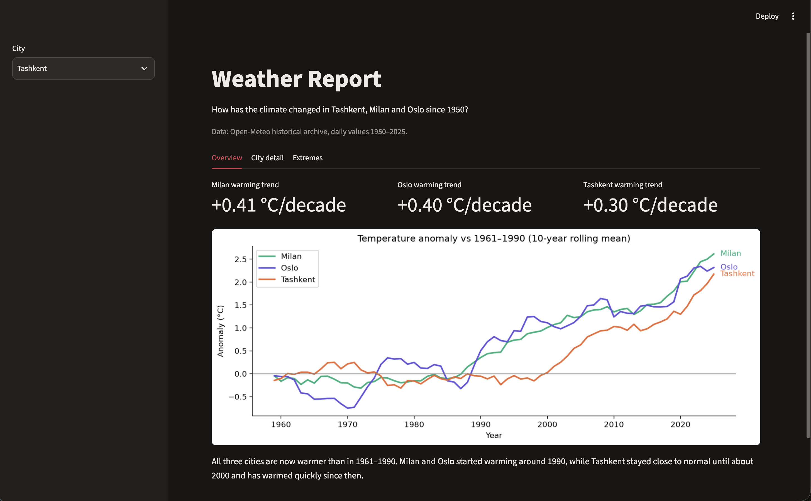

# Weather Report

How has the climate changed in Tashkent, Milan and Oslo since 1950?
This project downloads daily weather data from the Open-Meteo archive API, analyses temperature trends and presents the results in a Streamlit app.



## What it shows

- **Temperature anomalies:** each year compared with the city's 1961–1990 average (the WMO reference period).
- **Warming trend:** a linear regression of yearly temperature, in °C per decade, with its p-value.
- **Monthly heatmap:** mean temperature for every month and year.
- **Hot days:** days per year above the city's own 95th percentile of 1961–1990 maximum temperature.

## Data source

[Open-Meteo Historical Weather API](https://open-meteo.com/en/docs/historical-weather-api): daily mean temperature, maximum temperature and precipitation, 1950–2025.
No API key is needed. On the first run the data is downloaded and saved to `data/raw/`; later runs read those CSV files.

## Libraries

requests, pandas, numpy, scipy, matplotlib, seaborn, streamlit (exact versions in `requirements.txt`).

## Installation

```bash
git clone https://github.com/johnkhasan/weather-report.git
cd weather-report
python3 -m venv .venv
source .venv/bin/activate        # Windows: .venv\Scripts\activate
pip install -r requirements.txt
```

## Running

```bash
streamlit run app.py
```

The first start downloads the data and can take up to about a minute: if Open-Meteo's per-minute request limit is reached, the code waits 60 seconds and tries again.

## Project structure

```
weather-report/
├── app.py               # Streamlit app, only calls functions from weather/
└── weather/
    ├── config.py        # cities, date range, baseline period
    ├── fetch.py         # API request + CSV cache
    ├── clean.py         # cleaning + combining cities
    ├── analysis.py      # means, anomalies, trend, hot days
    └── plots.py         # plotting functions
```
